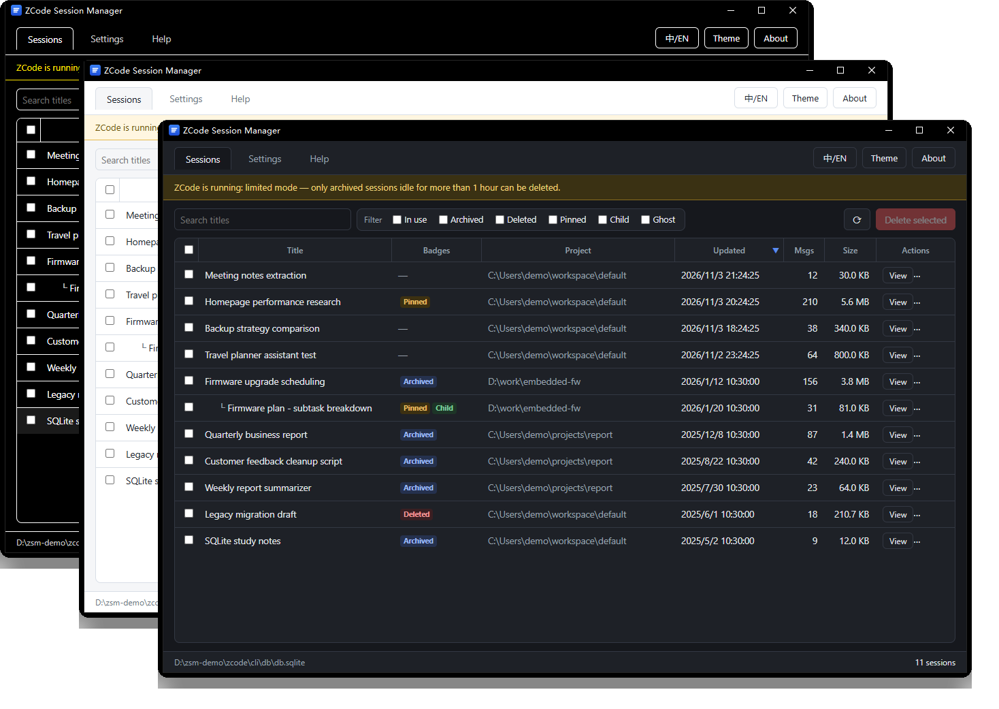

<div align="center">

# ZCode Session Manager

[简体中文](README.md) | English

**See the whole picture of your ZCode sessions — then decide what stays.**

</div>

ZCode has since grown a native delete: the "Archived sessions" page can restore, delete
individually, or permanently delete all archived sessions. **For everyday cleanup, the
built-in feature is enough.** This tool is not its replacement — it is a standalone, decoupled
session console for the parts the official UI does not show:

- **Standalone & decoupled** — a small independent program that neither requires nor disturbs a
  running ZCode; full freedom while ZCode is closed, automatic limited mode while it runs
- **Structure made visible** — the desktop list shows root conversations only; here sub-agent
  sessions sit in a parent/child tree, flagged archived / deleted / pinned / child / ghost,
  with category filters, message counts and disk usage
- **Know before you delete** — multi-select in bulk and preview the plan first: which sessions,
  which tables, how many bytes on disk. Nothing happens until you confirm
- **Reversible deletion** — automatic backup before, integrity check after, full auto-restore on failure
- **Blind-spot cleanup** — "ghost" index entries (a record with no content left) are detected and removed

<div align="center">
  
</div>

## Features

- **Full scan**: auto-locates the ZCode data directory (overridable), lists every session with
  title, project, message count, disk usage and status
- **Status at a glance**: archived / deleted / pinned / child / ghost shown as colored chips; child sessions
  are indented under their parent in a tree
- **Combinable filters & sorting**: multi-select category filters, click any column header to sort
- **Session detail**: read-only message stream — prompts, replies, thinking, tool calls and outputs
- **True deletion**: single or bulk delete with automatic cascade across the content database,
  raw model I/O records and on-disk artifacts
- **Bilingual / three themes**: English & Chinese UI, light / dark / high-contrast themes, window
  title follows the language

## Download & install

Grab the portable single file from
[Releases](https://github.com/woooooooooolf/zcode-session-manager/releases/latest)
(named `zsm-windows-x64-V<version>.exe`, ~11 MB) and run it.
Requires the system WebView2 runtime (preinstalled on Windows 10/11). The binary is unsigned —
if SmartScreen warns on first launch, choose "Run anyway".

> [!IMPORTANT]
> **Disclaimer**: this tool works alongside ZCode and relies on the session storage format of
> the current ZCode version. A future ZCode update may change that format (the tool detects the
> difference and refuses to operate). **Before real use, create a throwaway session and delete it
> with this tool to confirm everything matches.**

## Safety & transparency

Deletion is serious. Four safeguards keep it **controlled and reversible**:

1. **Backup first** — affected databases and session files are simple-copied to the backup
   directory (default `zsm-backups\<timestamp>\`, configurable in Settings) before anything is touched
2. **Verify after** — both databases get an automatic integrity check; on failure everything is
   **restored from that backup** and clearly reported
3. **Limited mode** — while ZCode is running, only archived sessions idle beyond a threshold
   (default 1 hour, configurable) can be deleted; threshold and probe interval are adjustable
4. **Compatibility check** — if the database layout differs from what the tool expects, all
   operations are refused with a warning instead of being executed blindly

Deletion scope (transparency): content database rows, raw model I/O records (rollout), execution
caches (exec / artifacts / image-cache / agents) and desktop index rows; shared data such as
`v2\checkpoints\`, `v2\visualizations\`, `backup\` and `memories\` is never touched.

## Development

```powershell
cargo test -p zsm-core                # core unit tests (throwaway fake databases)
cargo tauri dev                       # run in development
cargo build --release -p zsm-gui      # build the portable single file
cargo tauri build                     # build the NSIS installer
```

Pushing a `V*` tag makes GitHub Actions test, build and publish the Release automatically.

## License

[MIT](LICENSE)
