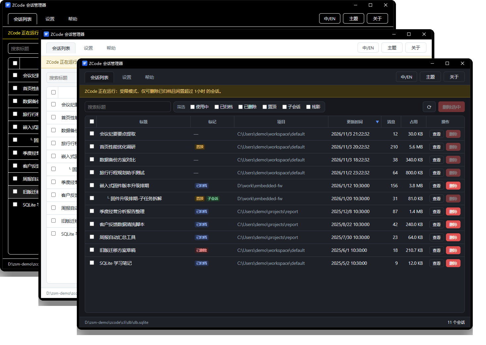

<div align="center">

# ZCode 会话管理器

简体中文 | [English](README.en.md)

**看清 ZCode 会话的全貌，再决定它们的去留。**

</div>

随着版本迭代，ZCode 已内置会话删除：在「已归档的会话」页可以恢复、单个删除或全部永久删除归档会话。
**日常清理，用官方功能就够了。** 本工具不是它的替代品，而是一个独立、解耦的会话管理台，
面向官方界面之外的角落：

- **独立解耦** —— 单独的小程序，不依赖也不占用正在运行的 ZCode；ZCode 关闭时可自由全量操作，
  检测到运行时自动切换受限模式
- **看得见结构** —— 桌面列表只呈现根会话；这里以父子树展示子代理会话及其派生关系，
  归档 / 已删除 / 置顶 / 子会话 / 残影状态各有标签，按类别筛选、查看消息数与磁盘占用
- **删前心里有数** —— 多选批量、先出删除计划：将波及哪些会话、哪些数据表、多少磁盘字节，
  确认后才执行
- **可逆的删除** —— 删除前自动备份，删除后完整性校验，异常时自动整体恢复
- **清理盲区** —— 识别并清理桌面索引中「有记录、无正文」的残影条目

<div align="center">
  
</div>

## 功能

- **全量扫描**：自动定位 ZCode 数据目录（可手动指定），列出全部会话的标题、项目、消息数、磁盘占用与状态
- **状态一目了然**：已归档 / 已删除 / 置顶 / 子会话 / 残影以彩色标签直接标注；子会话树形缩进在父会话之下
- **组合筛选与排序**：按类别多选组合过滤，点击列头即可正序 / 逆序排列
- **会话详情**：只读浏览完整消息流——提问、回答、思考过程、工具调用及其输出
- **彻底删除**：单删或多选批量删除，自动级联清理数据库正文、原始对话记录与磁盘关联文件
- **中英双语 / 三主题**：浅色、深色、高对比度；界面语言与窗口标题一键切换

## 下载与安装

从 [Releases](https://github.com/woooooooooolf/zcode-session-manager/releases/latest) 下载免安装单文件
（命名 `zsm-windows-x64-V<版本>.exe`，约 11 MB），双击即用。
需要系统自带的 WebView2 运行时（Windows 10/11 通常已内置）；未做代码签名，首次运行如遇
SmartScreen 提示，选择"仍要运行"即可。

> [!IMPORTANT]
> **使用声明**：本工具需与 ZCode 配合使用，按当前版本的会话存储格式工作。ZCode
> 官方未来调整会话保存格式的可能性无法排除（届时工具会检测到差异并拒绝操作）。
> **正式使用前，请先创建一个无意义的测试会话并对其执行删除，确认功能匹配后再处理真实数据。**

## 安全与透明

删除是严肃的操作。本工具用四道防线保证它**可控、可逆**：

1. **先备份** —— 删除前将涉及的数据库与全部会话文件简单拷贝到备份目录（默认 `zsm-backups\<时间戳>\`，可在设置中修改），随时可手工还原
2. **后校验** —— 删除完成后自动对数据库执行完整性检查，异常时**自动从本次备份整体恢复**并明确提示
3. **受限模式** —— 检测到 ZCode 正在运行时，仅允许删除已归档且闲置超过阈值（默认 1 小时，可设置）的会话，避免与 ZCode 自身的写入冲突；阈值与进程探测频率均可在设置中调整
4. **格式兼容检查** —— 数据库结构与本工具预期不符时，拒绝一切操作并提示，而不是盲目执行

删除范围（透明起见）：会话正文数据库行、原始模型输入输出记录（rollout）、执行缓存
（exec / artifacts / image-cache / agents）与桌面索引行；`v2\checkpoints\`、`v2\visualizations\`、
`backup\`、`memories\` 等共享数据不受影响。

## 开发

```powershell
cargo test -p zsm-core                # 核心逻辑单元测试（临时伪库，不碰真实数据）
cargo tauri dev                       # 开发运行
cargo build --release -p zsm-gui      # 构建免安装单文件
cargo tauri build                     # 构建 NSIS 安装包
```

推送 `V*` 标签时，GitHub Actions 会自动完成测试、构建与 Release 发布。

## 许可证

[MIT](LICENSE)
